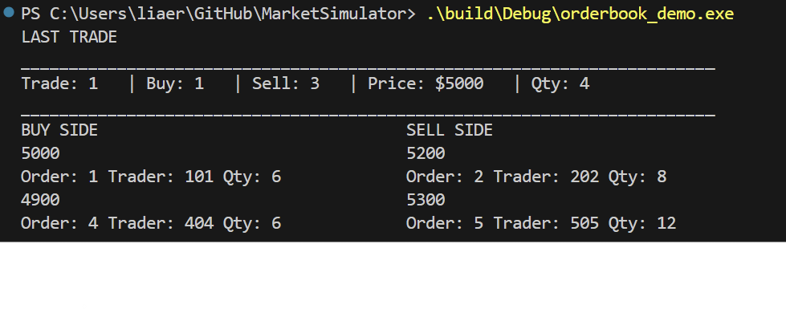

# C++ Market Simulator



A C++ limit order book and matching engine built to learn market microstructure, modern C++, concurrency, and performance measurement.

The project currently supports order placement, cancellation, price-time priority, trade recording, order-book snapshots, and separate debug and trader-facing views. The remaining work is focused on concurrent order flow and benchmarking rather than expanding the simulator with more features.

## Current Features

- Buy and sell limit orders
- Price-time priority
- FIFO execution within each price level
- Partial and full fills
- Order cancellation with trader ownership validation
- Direct active-order lookup by ID
- Best bid and best ask lookup
- Active-order quantity lookup
- Automatic cleanup of filled orders and empty price levels
- Integer-based prices to avoid floating-point comparison issues
- Trade history and most-recent-trade lookup
- Frozen order-book snapshots
- Debug display with order-level information
- Trader-facing display with aggregated depth, best bid, best ask, spread, and latest trade
- Catch2 and CTest test suite
- Separate CMake targets for the core library, tests, and demo executable

## Architecture

Each side of the order book is organized by price level:

- Sell prices are stored in ascending order, so the first level is the best ask.
- Buy prices are stored in descending order, so the first level is the best bid.
- Orders at the same price are stored in FIFO arrival order.

The implementation uses:

- `std::map` for ordered price levels
- `std::list` for FIFO order storage and stable iterators
- `std::unordered_map` for direct active-order lookup
- `std::vector<Trade>` for trade history
- `std::optional` for queries that may not contain a value
- Snapshot structs containing copied order-book state for display and inspection

Each order contains:

- Order ID
- Trader ID
- Side
- Limit price
- Remaining quantity
- Sequence number

Only remaining quantity is mutable after an order is created.

## Matching

Incoming orders match against the best available price on the opposite side of the book.

A buy order can execute against asks priced at or below its limit price. A sell order can execute against bids priced at or above its limit price.

Price priority is applied before time priority. Within the same price level, resting orders are matched FIFO.

Trades execute at the resting order's price. If quantities differ, the smaller remaining quantity is filled. Fully filled resting orders are removed from the book, while partially filled orders remain with their reduced quantity.

Any remaining quantity from an incoming order is added to the appropriate price level.

## Trade History

Each fill creates an immutable `Trade` containing:

- Trade ID
- Buy order ID
- Sell order ID
- Buyer trader ID
- Seller trader ID
- Execution price
- Executed quantity

Trades are stored in execution order.

## Snapshots and Displays

`BookSnapshot` creates a frozen copy of the current resting state of the order book.

It preserves:

- Buy price levels from highest to lowest
- Sell price levels from lowest to highest
- FIFO order within each price level
- Order ID
- Trader ID
- Sequence number
- Remaining quantity

The display logic is kept separate from the matching engine.

The debug view shows individual resting orders and internal IDs for inspecting matching behavior.

The trader view aggregates quantity by price level and shows:

- Best bid and available quantity
- Best ask and available quantity
- Bid-ask spread
- Aggregated book depth
- Latest execution price and quantity

## Build, Test, and Demo

The project uses CMake and Catch2.

From the repository root on Windows:

```powershell
cmake -S . -B build -A x64
cmake --build build
ctest --test-dir build
```

The current test suite contains 53 passing tests covering core `Order`, `OrderBook`, and `Trade` behavior.

To run the demo:

```powershell
.\build\Debug\orderbook_demo.exe
```

The demo prints both the debug and trader-facing views of a sample order book.

## Development Status

### Implemented

- [x] Order representation and validation
- [x] Ordered buy and sell price levels
- [x] Price-time priority
- [x] FIFO execution
- [x] Direct order lookup
- [x] Cancellation
- [x] Matching
- [x] Partial and full fills
- [x] Best bid / best ask lookup
- [x] Trade records and history
- [x] Catch2 and CTest integration
- [x] Order-book snapshots
- [x] Debug display
- [x] Trader-facing display
- [x] Demo executable

### Remaining

- [ ] Snapshot and display integration tests
- [ ] Minimal generated order flow for concurrency testing
- [ ] Multithreaded order submission
- [ ] Synchronization and thread-safety work
- [ ] Performance profiling and benchmarking
- [ ] Final cleanup and documentation

The project will be considered complete once these are done.

## Goals

The main goals of the project are to learn:

- Modern C++
- STL containers and iterator behavior
- Data-structure tradeoffs
- Matching-engine design
- Market microstructure
- Testing and build tooling
- Multithreading and synchronization
- Performance measurement and optimization

The remaining work is intentionally centered on concurrency and benchmarking. The simulation layer will stay minimal and only support those goals.